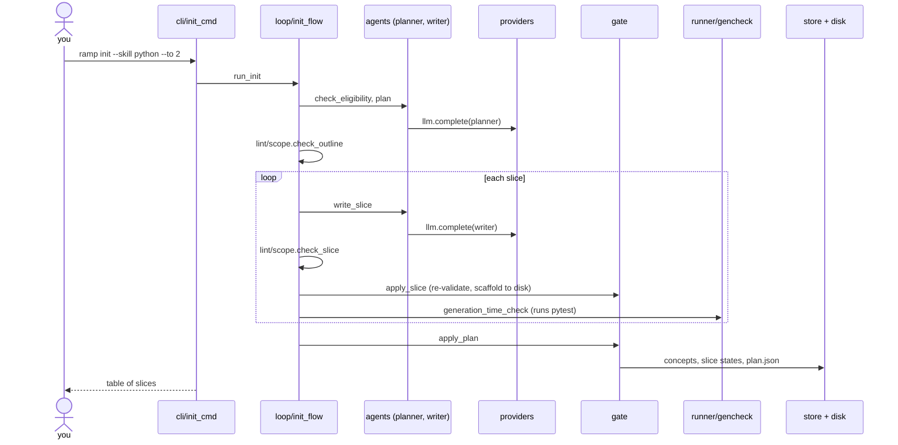
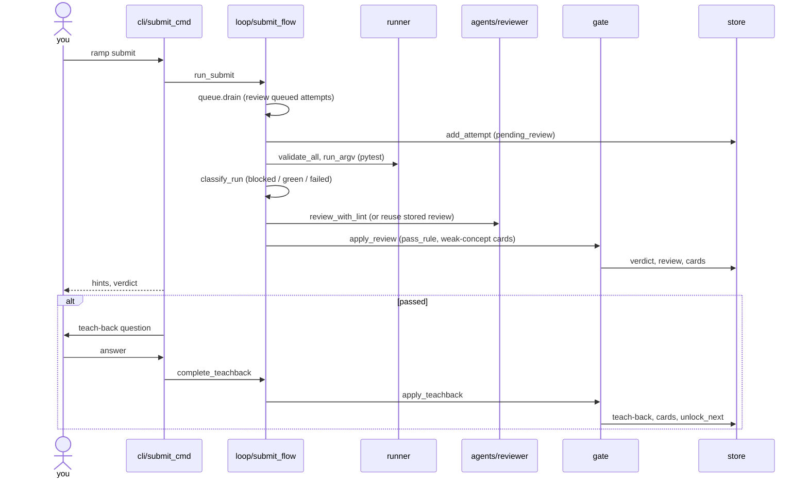

# How ramp works: a guided tour of the code

This is a walkthrough, not law. The constitution and the manifest in `docs/spec/` are the law; the diagrams there show the concepts. This file follows the **code**: which function runs when you type a command, and what it calls next.

Every reference below is a file path relative to `src/ramp/`, then a colon and a function, class or constant name. Line numbers are left out on purpose; search for the name. If the code moves, this guide can fall behind, so check it against the code when something looks off.

## 1. The shape in one minute

ramp is a set of small Python packages. A command always travels the same way:

```
cli  ->  loop  ->  agents / gate / runner / store / review / plan   (with providers behind agents)
```

- **`cli/`** turns what you type into a call and prints the result. No decisions.
- **`loop/`** is a thin sequencer, one file per command (`loop/init_flow.py`, `loop/today_flow.py`, `loop/submit_flow.py`, `loop/export_flow.py`, `loop/flag_flow.py`). It decides the *order* of steps and passes data along.
- **`agents/`** asks a language model one typed question and returns a validated answer. It never touches storage.
- **`providers/`** is the only code that talks to the network.
- **`gate/`** is the only way a model's answer reaches storage. It re-validates and then applies it.
- **`runner/`** is the only code that starts a subprocess (your tests, and git).
- **`store/`** is the only code that uses sqlite.
- **`review/`** holds the spaced-repetition maths (py-fsrs). **`plan/`** holds curriculum, scaffold and diff helpers. **`matrix/`** loads the law files. **`lint/`** holds the deterministic text checks.
- **`config.py`, `paths.py`, `models.py`** are shared leaf utilities, not modules: they never use sqlite, subprocess or the network.

The rule that explains most of the layout: **models propose, plain code decides.** A model's reply is a Pydantic object (`models.py`); only `gate/` turns it into a stored fact. `tests/test_invariants.py` enforces the import rules (for example `agents` never imports `store`).

## 2. Plumbing every command shares

1. **Entry.** `cli/__init__.py:COMMANDS` is the dispatch table; the five commands are `init`, `today`, `submit`, `export`, `flag-bridge`. Each command is one fresh process, with no daemon.
2. **Context.** Each command calls `cli/__init__.py:_context`, which calls `cli/wiring.py:make_context`. That is the composition root. It loads `config.toml`, opens the sqlite `Store` (`store/repos.py:Store`) and builds the model client. Everything the flows need travels in one `Context` (`cli/wiring.py:Context`: home, config, store, llm). Tests pass a `FakeLLM` (`providers/port.py:FakeLLM`) instead of the real client.
3. **Asking a model.** An agent calls `llm.complete(role, system, user, output_type)` (the protocol is `agents/base.py:LLM`). The real implementation is `providers/client.py:ProviderClient.complete`. It checks the spending caps (`providers/cost.py:CostMeter`), calls the HTTP transport (`providers/openrouter.py:OpenRouterTransport`), retries when the reply does not fit the expected shape, and writes the trace log (`providers/trace.py:Tracer`). Failures come back as `providers/port.py:ProviderOffline`, `ProviderFailed` or `CostCapExceeded`.
4. **Spend is stored without `providers` importing `store`.** `wiring` hands the meter a `store/ledger.py:StoreLedger`, so the daily total persists.
5. **Law files.** `matrix/loader.py:load_descriptors` and `load_claims` read `~/.ramp/descriptors.yaml` and `claims.yaml`. Descriptors marked `mock` are refused.

## 3. `ramp init`

Starts in `cli/__init__.py:init_cmd`.

1. `runner/git_helper.py:init_repo` makes `~/.ramp` a git repository (fixed argv, no model input).
2. `config.py:write_default` creates `config.toml` if missing, and `config.py:seed_law` copies the two law files in if missing. With placeholder models the command stops here with a message; that is the normal first run.
3. `_context` builds the context, then the command asks for hours and days and calls `loop/init_flow.py:run_init`.

`run_init` is the sequence:

| Step | Called | What happens |
|---|---|---|
| refuse overwrite | `store/repos.py:Store.list_slice_states` | an existing curriculum is never replaced |
| law | `matrix/loader.py:load_descriptors` | the level text for the skill and target |
| eligibility | `agents/planner.py:check_eligibility` | can every can-do be checked by a local command? If not, `InitRefused` |
| outline | `agents/planner.py:plan`, then `lint/scope.py:check_outline` | up to 1 + `max_regenerations` tries; tooling topics are sent back as feedback |
| each slice | `agents/writer.py:write_slice`, then `lint/scope.py:check_slice` | a draft with brief, bridges, tests and stubs; scope violations regenerate |
| write to disk | `gate/apply_plan.py:apply_slice` -> `plan/scaffold.py:scaffold_slice` | writes `slices/NN/workspace/`, a frozen `scaffold/src/`, `brief.md`, `slice.json` |
| pytest only | `loop/init_flow.py:_acceptance_violations` | acceptance commands must pass `runner/allowlist.py:validate_all` and be pytest runs |
| pre-flight | `runner/gencheck.py:generation_time_check` | tests must collect, and must not all pass on the empty scaffold |
| store | `gate/apply_plan.py:apply_plan` | concepts, slice states (first `current`, rest `locked`), and `plan.json` via `plan/curriculum.py:write_plan` |

A slice that fails any check is regenerated up to twice, then `SliceGenerationError` stops `init` with the cause. Nothing is recorded as a curriculum until every slice passes.



## 4. `ramp today`

Starts in `cli/__init__.py:today_cmd`.

1. `loop/today_flow.py:run_today` first calls `loop/queue.py:drain` (see section 6), then `loop/today_flow.py:_today`.
2. `_today` finds the current slice (`loop/today_flow.py:current_slice`) and the due cards (`review/__init__.py:due_cards`).
3. Back in the CLI, `cli/__init__.py:_review_cards` serves each due card. An answer goes to `loop/today_flow.py:answer_card`, which calls `agents/grader.py:grade_card` and then `gate/apply_grade.py:apply_grade`. That function uses `review/__init__.py:rate` (py-fsrs) to reschedule the card and stores the answer. A card is touched only by its own answer.
4. The CLI prints the brief and bridges, and `cli/__init__.py:_auto_export_if_open` exports on the way out.

If every slice is passed, `today` prints the finished message and still serves due cards.

## 5. `ramp submit`

Starts in `cli/__init__.py:submit_cmd`, which calls `loop/submit_flow.py:run_submit`.

1. `queue.drain` first, as in `today`.
2. `loop/submit_flow.py:_submit` fingerprints the acceptance commands, tests and fixtures (`runner/fingerprint.py:fingerprint`), diffs your `src/` against the frozen scaffold (`plan/diff.py:workspace_diff`), and **creates the attempt row immediately** as `pending_review`, so an interrupt always has a row to settle.
3. `loop/submit_flow.py:_run_attempt` validates the commands (`runner/allowlist.py:validate_all`) and runs each (`runner/exec.py:run_argv`). `loop/submit_flow.py:classify_run` sorts the result into `blocked` (not your code: timeout, start failure, or pytest exit 2-5 with an unchanged fingerprint), `green` or `failed`.
4. An empty diff short-circuits to `needs_work` with no model call.
5. Otherwise `loop/review_step.py:previous_review` reuses a stored review when the diff and test output are identical. If there is none, `loop/review_step.py:review_with_lint` asks `agents/reviewer.py:review_attempt`, then checks the reply with `lint/leak.py:check_hint` and `check_text`. A violation sends the reply back (up to twice), then `loop/review_step.py:sanitize` swaps in generic, lint-clean text.
6. `gate/apply_review.py:apply_review` applies the verdict. The pass rule is in `gate/pass_rule.py:pass_rule` and ignores the reviewer's own verdict: tests green, every target concept rated at or above the threshold with `file:line` evidence, and no leaked solution. Weak concepts get a card through `gate/apply_review.py:create_card`, only if the concept has none.
7. On a pass the CLI asks the teach-back (`cli/__init__.py:_teach_back`). `loop/submit_flow.py:complete_teachback` grades it (`agents/grader.py:grade_teachback`) and calls `gate/apply_grade.py:apply_teachback`, which stores it, adds `weak_teachback` cards for a grade of 2 or less, and **only then** calls `gate/apply_review.py:unlock_next`. A pass alone never unlocks the next slice.

Provider trouble during step 5 has two outcomes. `ProviderOffline` leaves the attempt `pending_review` (reported as "queued"). Any other `ProviderError` marks it `blocked` with the cause. Ctrl-C marks it `blocked` with cause `interrupted` (`loop/review_step.py:INTERRUPTED`).



## 6. The offline queue

The queue is in `loop/`, not in `providers/`. `providers` only raises `ProviderOffline`; it never stores anything.

- **Entering.** `loop/submit_flow.py:_run_attempt` catches `ProviderOffline` and leaves the attempt row as `pending_review`. The tests already ran and the output is stored.
- **Leaving.** `loop/queue.py:drain` runs at the start of `today` and `submit`. It reads the queue oldest first (`store/repos.py:Store.pending_attempts`) and judges each attempt from its stored diff and test output, without re-running tests. The stored output ends with a `[result: green]` or `[result: not green]` line (`loop/review_step.py:result_trailer`).
- **A row with no result line** never finished its tests (a killed process), so `drain` marks it `blocked` with cause `interrupted`.
- **A drained pass does not unlock.** You run a normal `ramp submit`, which reuses the stored review and then asks the teach-back.
- **Stops** when the provider is still offline or a cost cap is hit.

## 7. `ramp export` and `ramp flag-bridge`

- **export:** `cli/__init__.py:export_cmd` calls `loop/export_flow.py:run_export`. It writes the five JSONL files (`store/export.py:export_all`), commits them (`runner/git_helper.py:commit_export`, the only place besides `init_repo` that runs git), and prints the counts (`store/export.py:counts`). `today`, `submit` and `flag-bridge` also run `loop/export_flow.py:auto_export` at the end. A failure there is printed and never changes the command's result.
- **flag-bridge:** `cli/__init__.py:flag_bridge_cmd` calls `loop/flag_flow.py:flag_bridge`. It checks the slice and bridge number against the plan, then `store/repos.py:Store.add_bridge_flag`. Nothing is stored for an unknown slice or number.

## 8. Where state lives

| What | Where | Written by |
|---|---|---|
| curriculum | `~/.ramp/stacks/<skill>/plan.json` | `gate/apply_plan.py:apply_plan` |
| slice files | `~/.ramp/slices/NN/` (`workspace/`, `scaffold/`, `brief.md`, `slice.json`, `gencheck.log`) | `plan/scaffold.py:scaffold_slice`; you edit `workspace/src/` |
| progress | `~/.ramp/profile.db` (sqlite, not in git) | `store/repos.py:Store`, called only from `gate/`, `loop/` and `review/` |
| exports | `~/.ramp/exports/*.jsonl` (in git) | `store/export.py:export_all` |
| model logs | `~/.ramp/logs/llm-YYYY-MM-DD.jsonl` | `providers/trace.py:Tracer` |
| law and config | `~/.ramp/descriptors.yaml`, `claims.yaml`, `config.toml` | you (seeded once by `config.py:seed_law`) |

## 9. What each package may and may not do

| Package | Owns | Must not |
|---|---|---|
| `cli` | parsing, printing, prompts | decide anything |
| `loop` | the order of steps for one command | hold business rules, import `providers` internals |
| `agents` | prompts, typed model calls | import `store`, `providers`, or write files |
| `providers` | HTTP, retries, caps, tracing | import `store` |
| `gate` | validate then apply (the only LLM-to-storage path) | import `providers` |
| `runner` | subprocess: allowlisted argv, git helper | import `store` |
| `store` | sqlite, export files | anything but storage |
| `review` | FSRS maths, due cards | network, subprocess |
| `plan` | curriculum, scaffold, diff | be imported by anything except `gate` (for `scaffold`) |
| `matrix` | law loader | import `store` |
| `lint` | regex and schema checks | import `store` |

The enforced list is in `tests/test_invariants.py`.

## 10. Where to start reading

1. `cli/__init__.py:submit_cmd`, then `loop/submit_flow.py:run_submit`. It is the longest path and touches most packages.
2. `gate/pass_rule.py:pass_rule` and `gate/apply_review.py:apply_review` (the rule that decides a pass).
3. `loop/init_flow.py:run_init`.
4. `agents/reviewer.py:review_attempt` and `models.py:ReviewerOutput` (what a model is allowed to say).
5. `runner/allowlist.py:validate` (what a model-written command may do).
6. `loop/queue.py:drain`.
7. `tests/integration/test_lifecycle.py`. It runs the whole journey end to end with a scripted model, so it is the easiest thing to step through in a debugger.
